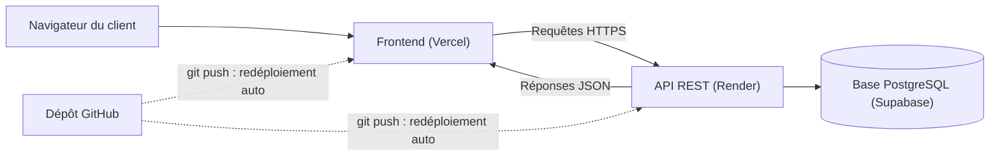

# TP Mise en production & Hébergement — Gestion de tickets

lien repo github : https://github.com/MikailLG/Herbegement

Application web trois tiers pour suivre les incidents informatiques.
Un utilisateur peut déclarer un incident, voir les tickets existants et changer leur statut (**Ouvert**, **En cours**, **Résolu**).

**Groupe :** Mikail, Ethan, Manu
---

## Liens publics

| Élément | URL |
|---|---|
| Frontend (Vercel) | `https://...` |
| API backend (Render) | `https://herbegement.onrender.com/` |
| Vérification de l'API | `https://herbegement.onrender.com/health` |

---

## Architecture

| Tier | Rôle | Hébergement |
|---|---|---|
| Frontend | Interface utilisateur | Vercel |
| Backend | API REST et logique métier | Render |
| Base de données | Stockage persistant (PostgreSQL) | Supabase |
| Code source | Versionnement | GitHub |

## Schéma

Le frontend ne parle jamais directement à la base de données : il passe toujours par l'API.
Les identifiants de la base restent côté backend.

---

## API

| Méthode | Route | Fonction |
|---|---|---|
| GET | `/api/tickets` | Récupérer les tickets |
| POST | `/api/tickets` | Créer un ticket |
| PATCH | `/api/tickets/:id` | Modifier le statut d'un ticket |
| GET | `/health` | Vérifier que l'API répond |

Les réponses sont en JSON.

## Table `tickets`

| Champ | Type | Description |
|---|---|---|
| id | UUID ou entier | Identifiant unique |
| titre | TEXT | Titre du ticket |
| description | TEXT | Description de la demande |
| statut | TEXT | Ouvert, En cours ou Résolu |
| created_at | TIMESTAMP | Date de création |

---

## Déploiement

1. **Base de données** : création de la base PostgreSQL sur Supabase et de la table `tickets`.
2. **Backend** : déploiement sur Render depuis GitHub, avec la variable d'environnement `DATABASE_URL`. Aucun secret n'est dans le code.
3. **Frontend** : déploiement sur Vercel depuis GitHub, avec l'URL publique de l'API Render.
4. **CI/CD** : chaque `git push` sur GitHub déclenche automatiquement un nouveau déploiement.

### Variables d'environnement

| Variable | Service | Rôle |
|---|---|---|
| `DATABASE_URL` | Render | Connexion à la base Supabase |

Les valeurs ne sont jamais publiées dans le dépôt.

---

## Compte rendu technique

### Choix d'hébergement

- **Vercel (frontend)** : déploiement simple depuis GitHub, HTTPS automatique.
- **Render (backend)** : hébergement de l'API relié à GitHub, avec gestion des variables d'environnement et des logs.
- **Supabase (base de données)** : PostgreSQL hébergé et gratuit, avec une URL de connexion prête à l'emploi.
- **GitHub (code source)** : versionnement du code et point de départ des déploiements automatiques.

### Problème rencontré et résolution

- **Problème** : chemin qui sort "not founf"
- **Résolution** : Pour réussir à régler le soucis, je suis passer sur une session pooler directement sur render.

### Limites des offres gratuites

Sur l'offre gratuite de Render, l'API se met en veille si elle n'est pas utilisée. La première requête peut donc prendre quelques secondes.

---

## Répartition du travail

- **Mikail** : base de données Supabase, déploiement du backend sur Render, variables d'environnement.
- **Ethan** : déploiement du frontend sur Vercel, liaison avec l'API, test du redéploiement automatique (CI/CD).
- **Manu** : dépôt GitHub, README, schéma d'architecture et compte rendu technique.